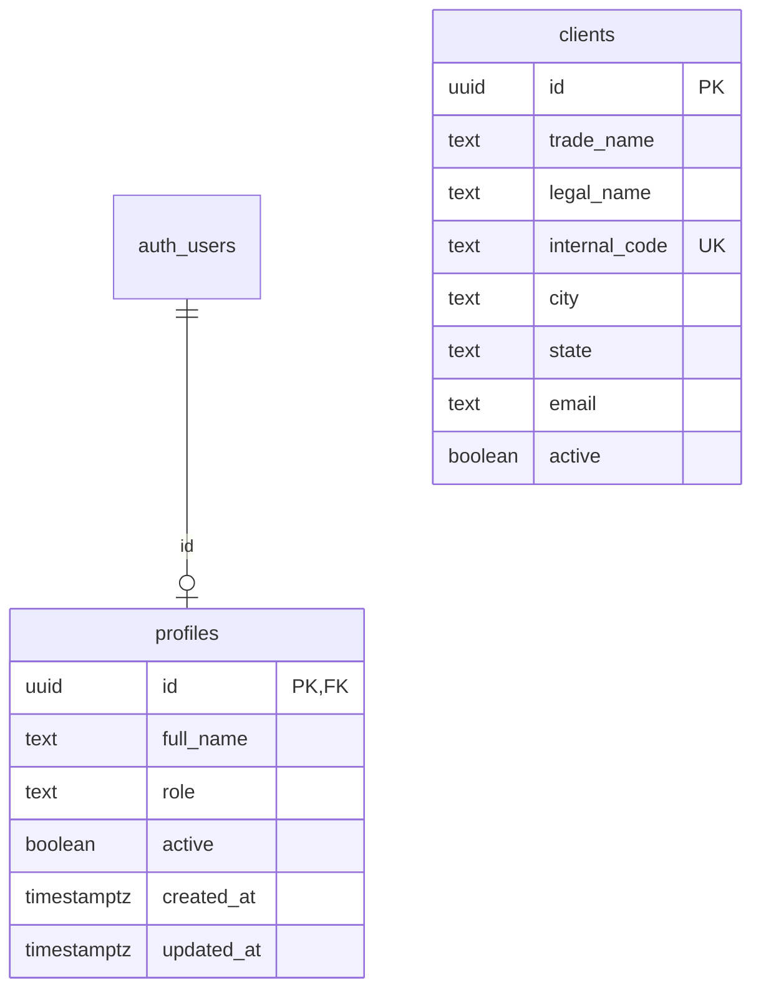

# Fundação do banco acadêmico — 14/10/2026

## Entrega aplicada

Primeira implementação incremental no projeto acadêmico Supabase **Univesp**, separado do ambiente profissional. Branch: `codex/banco-fundacao-academica`, baseada na main. Esta entrega não depende da integração do menu (PR #5).

O esquema `public` foi consultado antes da aplicação e não continha tabelas. Foram criadas `profiles` e `clients`, com chaves, restrições, índices e atualização automática de `updated_at`. Foram inseridos três clientes inteiramente fictícios. Não foram criados usuários de autenticação ou perfis privilegiados.

## Modelo implementado

O diagrama é resumido; a definição completa está na [migração](../../supabase/migrations/20261014000100_fundacao.sql). O DER anterior documenta oito tabelas da origem, não o estado atual deste banco. Carteiras, vendedores, visitas, localizações e pedidos serão adicionados por migrações futuras.

### Decisões desta etapa

- Perfil exige usuário existente em `auth.users`, papel válido e nome preenchido. Padrão: vendedor inativo; nenhuma atribuição de papel a partir de metadados enviados pelo cliente.
- Não há trigger de criação de perfil no Auth ainda. Provisionamento e permissões serão tratados na etapa de autenticação.
- Não duplicamos o e-mail do Auth em `profiles`, evitando uma cópia que precisaria ser sincronizada.
- Cliente exige nome fantasia e cidade. Razão social é opcional. Endereço e demais campos são opcionais nesta fundação; regras adicionais poderão ser incluídas com o cadastro.
- Código interno é único desconsiderando espaços nas extremidades e maiúsculas/minúsculas; vazio é rejeitado e nulo é permitido.
- Coordenadas precisam ser informadas em par, dentro das faixas válidas. UF, quando informada, exige duas letras maiúsculas; não valida a lista de UFs nesta fase.
- `updated_at` é mantido automaticamente; isso não substitui uma trilha de auditoria.
- RLS habilitado e privilégios revogados de PUBLIC, anon e authenticated nas duas tabelas. Nenhuma policy de liberação foi criada. A aplicação ainda não acessa o banco; administração pelo painel permanece possível.
- O relatório de comissão será usado apenas para importar pedidos, sem cálculo de comissão.

## Scripts e reprodução

1. Em um projeto acadêmico novo, confirmar que as tabelas de destino não existem.
2. Executar integralmente `supabase/migrations/20261014000100_fundacao.sql` no SQL Editor. A transação impede criação parcial. A migração é de execução única e não deve ser repetida sobre as tabelas já criadas.
3. Executar `supabase/seeds/clientes_demo.sql`. A carga pode ser repetida: os IDs fixos existentes são preservados. Conflito de código com outro ID gera erro e deve ser revisado, não sobrescrito.
4. Executar integralmente `supabase/tests/fundacao_test.sql`, sem selecionar trechos. O teste reverte seus registros temporários com ROLLBACK e retorna PASSOU. Se houver erro, interromper e executar ROLLBACK antes de investigar; não interpretar mensagens posteriores como aprovação.

A aplicação desta entrega foi manual pelo SQL Editor. Não foi registrada automaticamente na tabela de histórico do Supabase CLI. Antes de adotar `db push`, comparar o esquema e reconciliar o histórico da versão `20261014000100` com a migração já aplicada; não reaplicá-la cegamente. Não executar reset no projeto remoto.

## Verificação executada

| Verificação | Resultado |
| --- | --- |
| Criação das tabelas | Sucesso |
| RLS ativo nas duas tabelas | 2 tabelas |
| Policies e privilégios públicos não previstos | Nenhum encontrado |
| Nome vazio e coordenadas inválidas/incompletas | Rejeitados |
| Código interno duplicado com variação de caixa/espaços | Rejeitado |
| Perfil sem usuário Auth | Rejeitado pela FK |
| Leitura de clientes como anon | Bloqueada |
| Leitura de perfis e inserção de cliente como authenticated | Bloqueadas |
| Repetição da carga fictícia | Continuou com 3 clientes |
| Estado final | 3 clientes e 0 perfis |

Os testes verificam restrições e privilégios no PostgreSQL. Não são testes HTTP da API, testes de login ou validação das futuras políticas por carteira. Não houve conexão do Flutter com o banco, nem validação de backup/restauração.

## Próximas etapas

Autenticação e provisionamento controlado de perfis; definição das regras de gestor e carteira; cadastro de clientes; usuários/vendedores; visitas; importação dos pedidos. Cada módulo receberá migração e testes próprios. A integração do Git à main não executa SQL automaticamente.

Referências: [RLS no Supabase](https://supabase.com/docs/guides/database/postgres/row-level-security) e [dados de usuários](https://supabase.com/docs/guides/auth/managing-user-data). Credenciais e dados profissionais não integram os arquivos versionados.
