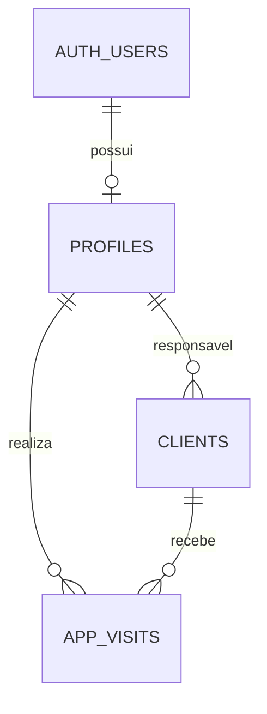

# Clientes, visitas e acesso por perfil

Entrega de 22/10/2026, branch `codex/clientes-visitas-autenticacao`.

## Funcionalidades

- Login pelo Supabase Auth com e-mail e senha, manutenção da sessão e saída.
- Início com contagem de clientes e visitas por situação, além dos próximos atendimentos.
- Clientes: novo cadastro, edição, ativação, responsável, contato, telefone/WhatsApp, e-mail e endereço.
- A listagem apresenta a pessoa de contato e o telefone. O botão verde abre o WhatsApp para o número informado, sem enviar mensagens automaticamente. Números nacionais recebem o código 55; números internacionais podem usar o prefixo `+`.
- Ações por cliente: editar, agendar visita ou iniciar atendimento.
- Visitas: agendar, iniciar, concluir com observações e cancelar agendamentos. Os horários de início e conclusão são registrados pelo servidor.
- Usuários: consulta dos perfis existentes. Não há criação ou alteração de contas pela interface nesta entrega.

Todos os cadastros e atendimentos deste ambiente devem ser fictícios. A funcionalidade de registrar contatos comerciais, separada das visitas, não faz parte do escopo.

## Contas e permissões

As contas `adm@academico.com.br` e `vendedor@academico.com.br` já existiam no Auth e foram associadas a perfis ativos. Senhas não fazem parte deste documento ou do código.

| Perfil | Acesso |
| --- | --- |
| Administrador | Todos os clientes, visitas e perfis; pode definir o responsável pelo cliente |
| Vendedor | Clientes da própria carteira, suas visitas e seu próprio perfil |
| Anônimo ou perfil inativo | Sem acesso aos dados das tabelas operacionais |

Os três clientes fictícios iniciais foram associados ao vendedor. Os cinco personagens de `academic_demo.users` continuam sendo exemplos isolados, não contas de login.

## Banco

Aplicar em ordem as migrations de `supabase/migrations/`. A fundação cria `public.profiles` e `public.clients`; a nova migration adiciona `clients.seller_id`, `public.app_visits`, políticas RLS e funções para transições de visitas.



Uma visita passa de agendada para em andamento e depois concluída; um agendamento pode ser cancelado. Cada usuário pode manter apenas uma visita em andamento. A interface não recebe permissão de escrita direta na tabela de visitas: utiliza funções que verificam o usuário e o estado anterior.

O esquema `academic_demo` permanece independente. A importação do HTML demonstrativo continua em memória, sem cálculo de comissão e sem sincronização dos pedidos pelo aplicativo.

## Execução

Criar um arquivo local `config.local.json`, ignorado pelo Git, com `SUPABASE_URL` e `SUPABASE_ANON_KEY`. O segundo valor deve ser a chave pública publishable do projeto, nunca uma chave secret ou service_role.

```sh
flutter pub get
flutter analyze
flutter test
flutter run -d chrome --dart-define-from-file=config.local.json
flutter build web --release --dart-define-from-file=config.local.json
```

Sem configuração, o aplicativo abre a demonstração estática. Para publicar o acesso autenticado, usar obrigatoriamente a configuração do projeto acadêmico. O Cloudflare recebe somente o conteúdo de `build/web`.

## Verificações

- Análise estática sem apontamentos e sete testes Flutter aprovados (menu, importação e contato/WhatsApp).
- `supabase/tests/clientes_visitas_auth.sql` aprovado no banco acadêmico: isolamento entre vendedores, bloqueio de edição de outro cliente, impedimento de alteração do próprio perfil, ciclo de visita, transição inválida, conta inativa e acesso anônimo. A transação de teste é revertida ao final.
- Perfis administrador e vendedor ativos conferidos no banco.
- Teste pelo navegador com as duas contas: cadastro de `DEMO-004`, edição da pessoa de contato, consulta pelo vendedor, agendamento, início e conclusão de uma visita fictícia. Os registros ficam disponíveis para o ensaio do vídeo.

## Roteiro para demonstração

1. Entrar como administrador sem exibir a senha na gravação; apresentar os indicadores e o menu.
2. Abrir Usuários e explicar os dois perfis e seus limites.
3. Abrir Clientes, criar um cliente fictício com código único, cidade, pessoa de contato e telefone demonstrativo; atribuir ao vendedor.
4. Editar o cliente, recarregar e mostrar a informação preservada. Apontar o botão do WhatsApp sem iniciar conversa com um número fictício.
5. Agendar uma visita, iniciá-la e concluí-la com um breve resumo fictício. Mostrar o histórico e a atualização dos indicadores.
6. Sair e entrar como vendedor; mostrar que a carteira e as visitas são filtradas por usuário.
7. Se apresentar a importação, explicar que continua sendo uma demonstração separada, usando o HTML fictício, sem cálculo de comissão.

Pendências: administração de contas pela interface, importação autenticada persistente, filtros mais completos e publicação automática. Não apresentar essas funcionalidades como concluídas no vídeo.

## Publicação

Versão integrada publicada no Cloudflare Pages em 22/10/2026, no endereço https://movisitas-academico.pages.dev/. A tela de login foi conferida no endereço público. A publicação usa upload direto do build; as branches no GitHub continuam seguindo revisão por entrega.
