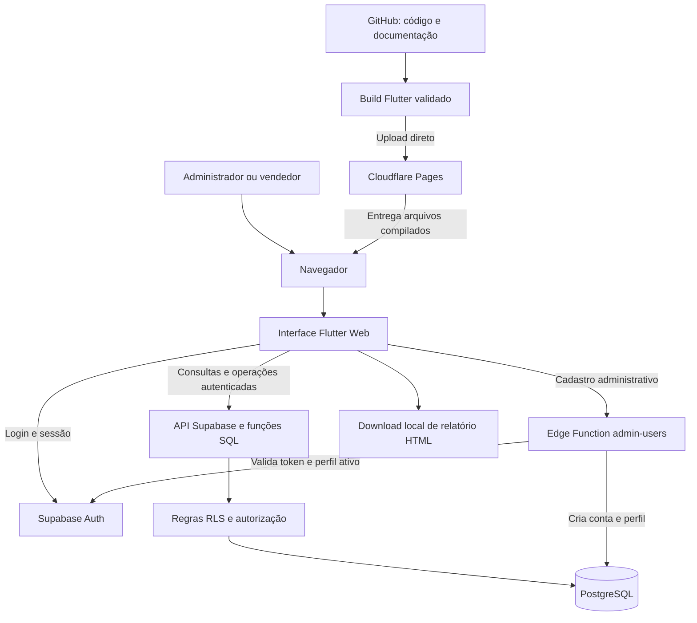
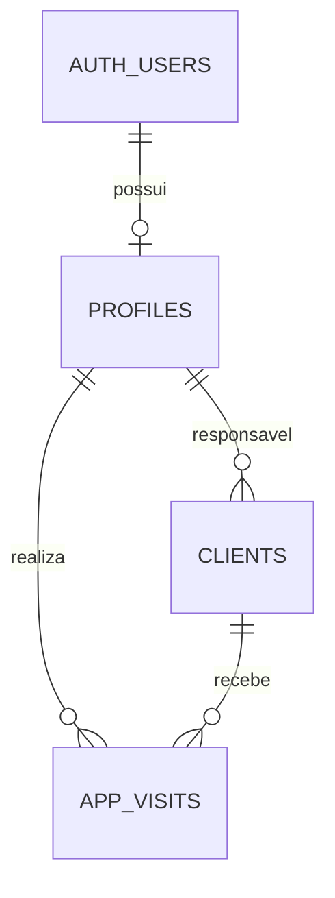

# Tecnologias, arquitetura e funcionamento do Movisitas

Referência documental: 27/10/2026. Este guia descreve a implementação acadêmica do repositório, incluindo a exportação agrupada publicada em 26/10/2026. Os documentos de cada fase preservam o histórico de suas entregas; funcionalidades previstas nos protótipos não equivalem a funcionalidades implementadas.

## 1. Visão geral

O Movisitas organiza a carteira de clientes e as visitas comerciais. O administrador acompanha a equipe e gerencia usuários; o vendedor utiliza sua própria carteira e registra seus atendimentos. O ambiente acadêmico utiliza dados fictícios.

A aplicação funciona no navegador. O Cloudflare Pages entrega os arquivos da interface; o Supabase autentica os usuários e fornece acesso controlado ao PostgreSQL. O GitHub guarda o código e os documentos, mas não é o banco de dados do sistema.

## 2. Tecnologias e responsabilidades

| Tecnologia | O que é | Uso no projeto |
| --- | --- | --- |
| Dart | Linguagem de programação | Código das telas, validações, consultas e geração de relatórios. O `pubspec.yaml` declara SDK `^3.13.4`. |
| Flutter Web | Framework de interface | Menus, formulários, painel e navegação responsiva. O build transforma o projeto em arquivos servidos ao navegador. |
| Supabase | Plataforma de serviços de backend | Reúne autenticação, API do banco e funções executadas no servidor. |
| PostgreSQL | Banco de dados relacional | Armazena perfis, clientes e visitas em tabelas relacionadas por identificadores. |
| SQL e PL/pgSQL | Linguagens utilizadas no banco | Definição de tabelas, relacionamentos, regras de acesso e funções das operações. |
| Supabase Auth | Serviço de autenticação | Login com e-mail e senha, identificação do usuário e sessão autenticada. |
| RLS | Segurança por linha do PostgreSQL | Restringe os registros acessíveis conforme o usuário e seu perfil ativo. |
| Edge Function em TypeScript | Código executado no servidor | A função `admin-users` cria contas após validar a identidade e a permissão administrativa. |
| Cloudflare Pages | Hospedagem de arquivos web | Publica a interface em `movisitas-academico.pages.dev`, por upload direto. |
| Git / GitHub | Controle de versões / hospedagem do repositório | Histórico de alterações, branches, revisão por Pull Request e documentação. |
| HTML e CSS | Estrutura e apresentação de documentos web | Relatórios de visitas exportados e exemplos fictícios de vendas. |

## 3. Arquitetura



A interface não guarda a chave administrativa do Supabase. O navegador recebe a URL e uma chave pública do projeto; a proteção dos dados depende da sessão, das políticas RLS e das verificações no servidor, não de esconder botões.

## 4. Caminho de uma operação

1. O navegador carrega o aplicativo publicado no Cloudflare.
2. O usuário entra pelo Supabase Auth. A aplicação consulta seu perfil e verifica se ele está ativo.
3. Ao consultar clientes, a API acessa as tabelas respeitando as permissões do usuário.
4. Ao iniciar ou concluir uma visita, a aplicação chama funções do banco que verificam autorização e transição de estado. Os horários dessas operações são registrados pelo servidor.
5. O aplicativo atualiza a tela com os registros retornados pelo serviço.
6. Ao exportar, consulta novamente os dados autorizados, aplica os filtros e gera um arquivo HTML no navegador. O download não altera as visitas.

## 5. Dados e regras de negócio

| Estrutura | Responsabilidade |
| --- | --- |
| `auth.users` | Contas de autenticação gerenciadas pelo Supabase Auth. |
| `public.profiles` | Nome, perfil e situação ativa da conta. |
| `public.clients` | Cadastro de clientes, contato, WhatsApp e vínculo com o vendedor. |
| `public.app_visits` | Cliente, responsável, situação, agendamento, início, conclusão e observações da visita. |
| `academic_demo` | Carga fictícia independente, utilizada na etapa demonstrativa; não representa contas de login nem sincronização com as telas operacionais. |



O ciclo normal é **Agendada → Em andamento → Concluída**. Um agendamento também pode ser cancelado. Apenas uma visita em andamento é permitida por responsável. A desativação de usuário preserva seus vínculos e histórico; não corresponde à exclusão física da conta.

O administrador acessa a equipe e gerencia contas. O vendedor acessa sua carteira, suas visitas e seu perfil. Contas inativas e acessos anônimos não recebem acesso às tabelas operacionais. Consulte [permissões e visitas](CLIENTES_VISITAS_AUTENTICACAO.md) e [administração de usuários](USUARIOS_ADMIN.md).

A documentação em `Banco_de_Dados/` analisa também o esquema do projeto de origem. Ela não deve ser interpretada como uma lista de todas as tabelas efetivamente utilizadas pela versão acadêmica. Para essa versão, consultar as migrations do repositório e os documentos de implementação.

## 6. Funcionalidades e limites atuais

- Painel comercial com indicadores, filtros e cartões que abrem os registros correspondentes.
- Cadastro e edição de clientes, atribuição de responsável, pessoa de contato e link de WhatsApp. O link não envia mensagens automaticamente.
- Agenda, início, conclusão, cancelamento e histórico de visitas.
- Administração de usuários: criação, edição de nome/perfil e desativação/reativação. E-mail e senha de contas existentes não são alterados pela edição de perfil.
- Exportação HTML por status, responsável e período; agrupamento sem separação, por status, por vendedor ou por vendedor e status, com quantidades por seção. O período do relatório considera a data agendada, incluindo os dias inicial e final. Os indicadores do painel possuem critérios próprios, descritos no [guia do painel](PAINEL_COMERCIAL.md).
- Importação de pedidos do relatório de comissão: demonstração em memória, sem cálculo de comissão e sem persistência autenticada de pedidos pelo aplicativo. A carga independente do banco não constitui integração dessa importação.

Há diferenças entre protótipo, demonstração estática e aplicação autenticada. Sem configuração do Supabase, o aplicativo abre o modo demonstrativo. Com configuração, utiliza login e os módulos operacionais. Consulte [exportação](EXPORTACAO_VISITAS.md) e [dados fictícios](DADOS_FICTICIOS.md).

## 7. Organização do código

| Caminho | Conteúdo |
| --- | --- |
| `lib/main.dart` | Inicialização e leitura da configuração pública do Supabase. |
| `lib/` | Interface, navegação, acesso a dados e geração dos relatórios. |
| `assets/` | Arquivos fictícios utilizados na demonstração. |
| `web/` | Arquivos de entrada web e exemplo de vendas. |
| `test/` | Testes automatizados da aplicação. |
| `supabase/migrations/` | Evolução versionada da estrutura e regras do banco. |
| `supabase/functions/admin-users/` | Função de criação administrativa de contas. |
| `supabase/tests/` | Verificações SQL das regras de acesso e operações. |
| `Documentos/` | Guias técnicos, modelagem, planejamento e materiais acadêmicos. |
| `build/web/` | Resultado gerado pela compilação; não é o código-fonte e não é versionado. |

## 8. Configuração e execução

Instalar Git e Flutter com suporte web e uma versão de Dart compatível com `pubspec.yaml`. Executar `flutter doctor` para verificar o ambiente. Na raiz do projeto, criar `config.local.json`, já ignorado pelo Git:

```json
{
  "SUPABASE_URL": "https://SEU-PROJETO.supabase.co",
  "SUPABASE_ANON_KEY": "SUA-CHAVE-PUBLICA-PUBLISHABLE"
}
```

São valores ilustrativos. Apesar do nome histórico `SUPABASE_ANON_KEY`, o código passa esse valor como `publishableKey`. Nunca colocar senha, chave secret ou `service_role` nesse arquivo de build: valores usados pelo aplicativo web podem ser lidos pelo navegador.

```sh
flutter pub get
flutter analyze
flutter test
flutter run -d chrome --dart-define-from-file=config.local.json
```

Para preparar um projeto Supabase novo, aplicar as migrations na ordem dos nomes, verificando primeiro o histórico de aplicação:

1. `20261014000100_fundacao.sql`: fundação do banco.
2. `20261021000100_demonstracao.sql`: ambiente de demonstração isolado.
3. `20261021000200_clientes_visitas_auth.sql`: clientes, visitas e acesso autenticado.
4. `20261023000300_admin_usuarios.sql`: operações administrativas de perfis.

Não executar novamente os scripts indiscriminadamente em um banco existente. Preparar a primeira conta administrativa pelo responsável pelo ambiente, associando sua conta Auth a um perfil ativo. Publicar também a função `admin-users`, conforme [guia de usuários](USUARIOS_ADMIN.md). Sua validação de token por `getUser` e de administrador ativo deve ser preservada; a configuração do gateway está explicada naquele documento. Credenciais privilegiadas ficam exclusivamente no servidor.

As migrations não representam uma cópia de segurança dos registros. Manter um procedimento de backup e restauração antes de alterações de banco; este guia não afirma que uma rotina automática de backup foi configurada.

## 9. Publicação e manutenção

```sh
flutter build web --release --dart-define-from-file=config.local.json
```

Enviar somente o conteúdo de `build/web` ao projeto Cloudflare Pages existente. O ZIP deve conter `index.html` na raiz. Aguardar o sucesso e verificar login, navegação e a funcionalidade alterada no endereço público. O procedimento completo está em [publicação no Cloudflare](DEPLOY_CLOUDFLARE.md).

O ambiente usa **Direct Upload**: enviar um commit ou aceitar um Pull Request não faz deploy automático. Da mesma forma, publicar o frontend não aplica migrations nem publica Edge Functions. São entregas separadas que precisam ser coordenadas quando uma mudança depende do banco.

Cada alteração deve ter branch, documentação e verificação proporcionais ao impacto, seguida de revisão para incorporação à `main`. Não incluir dados profissionais ou senhas nos exemplos, relatórios acadêmicos, vídeos ou commits.

## 10. Verificações e pendências

Este documento foi conferido com o código e os guias versionados; sua elaboração não executou nova auditoria do Supabase remoto nem um novo deploy. A última melhoria de exportação foi registrada no commit `d4e223f`, com testes, análise estática, build e download agrupado conferidos em 26/10/2026.

Permanecem como evolução: importação autenticada persistente, publicação automática e revisão integral dos materiais acadêmicos. O teste completo de criação de nova conta pelo formulário permanece com a ressalva registrada no guia de usuários. Entrevista simulada e vídeo são materiais complementares; não equivalem a validação real pelo cliente.
