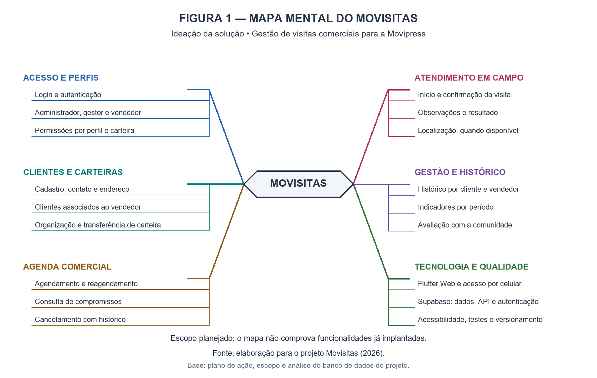
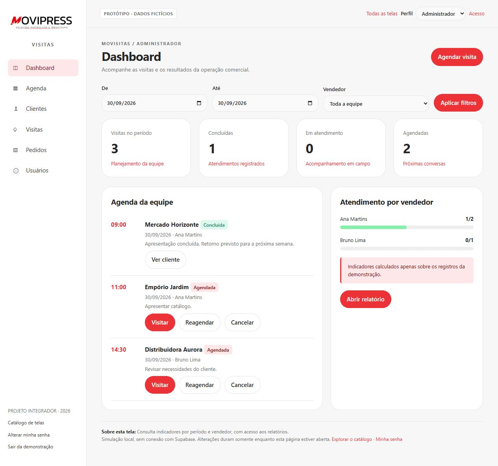

# Movisitas

Gestão de visitas comerciais para a Movipress.

Projeto acadêmico da disciplina **PJI240-DRP11 — Projeto Integrador em Computação II**, Univesp, segundo semestre de 2026, Grupo 17.

## Problema e objetivo

Centralizar clientes, agendas, vendedores e históricos de atendimento para melhorar a organização e o acompanhamento das visitas comerciais da Movipress.

## Situação atual

**Aplicação acadêmica com login, clientes e visitas integrados ao Supabase**, além da demonstração de importação com dados fictícios. Endereço: [movisitas-academico.pages.dev](https://movisitas-academico.pages.dev/). A entrega de 22/10/2026 inclui os perfis administrador e vendedor, cadastro e edição de clientes, contato/WhatsApp e ciclo de visitas. Consulte [funcionalidades, permissões e roteiro atualizado](Documentos/CLIENTES_VISITAS_AUTENTICACAO.md). A importação permanece demonstrativa, sem gravação dos pedidos pelo aplicativo.

O código de origem já existia antes desta migração. Os commits deste repositório registrarão sua incorporação e adaptação ao projeto acadêmico, além dos novos desenvolvimentos realizados pelo grupo.

## Documentação

- [Guia do sistema e roteiro falado para vídeo](Documentos/GUIA_E_ROTEIRO_VIDEO.md)

- [Plano de ação do grupo](Documentos/Plano_de_acao-PJI240-DRP11-A2026S2-Grupo_17.pdf)
- [Orientações da disciplina](Documentos/PI.txt)
- [Plano de migração por fases](Documentos/PLANO_DE_MIGRACAO.md)
- [Escopo e arquitetura previstos](Documentos/ESCOPO_E_ARQUITETURA.md)
- [Banco de dados: MER, DER, dicionário e Supabase](Documentos/Banco_de_Dados/README.md)

## Evolução por fases

| Fase | Branch | Entrega registrada | Situação |
| --- | --- | --- | --- |
| 1 — Estrutura inicial | `fase-1/estrutura-inicial` | Apresentação, escopo e planejamento; commit `30882fd` | Integrada à main pelo PR #1 |
| 2 — Modelagem do banco | `fase-2/modelagem-banco` | MER, DER, dicionário, análise de integridade e Supabase; commit `3e3d17b` | Entrega documental do PR #2; validação do banco remoto pendente |
| 3 — Fundação da aplicação | `codex/fase-3-menu-principal` | Estrutura Flutter, identidade e menu; commit `680843c` | Publicada para demonstração; PR #5 em revisão |
| 4 — Solução inicial | `codex/clientes-visitas-autenticacao` | Login, carteira de clientes, contato/WhatsApp, perfis e visitas no Supabase | Implementação e validação em 22/10/2026 |
| 5 a 7 — Melhorias, validação e entrega final | A criar | Evolução conforme retorno da comunidade, testes e materiais acadêmicos | Planejadas |

A fase 2 parte da entrega da fase 1 e inclui seus arquivos. A numeração identifica as entregas técnicas e não corresponde diretamente às quinzenas da faculdade. Consulte os períodos no [plano de migração](Documentos/PLANO_DE_MIGRACAO.md).

## Documentação do banco

A análise abrange **13 migrations, 8 tabelas da aplicação e 75 colunas** do projeto de origem:

- [MER: entidades, cardinalidades e regras](Documentos/Banco_de_Dados/01_MER.md)
- [DER: chaves, relacionamentos e índices](Documentos/Banco_de_Dados/02_DER.md)
- [Dicionário completo dos dados](Documentos/Banco_de_Dados/03_DICIONARIO.md)
- [Normalização, integridade e melhorias propostas](Documentos/Banco_de_Dados/04_ANALISE.md)
- [Supabase: arquitetura, autenticação e permissões](Documentos/Banco_de_Dados/05_SUPABASE.md)
- [Rastreabilidade e plano de validação](Documentos/Banco_de_Dados/06_VALIDACAO.md)

O esquema foi reconstruído dos scripts locais. Não houve inspeção do banco remoto, execução de migrations ou testes de integração nesta entrega. Os achados de revisão estão documentados para orientar a implementação. A tabela de pedidos ERP é uma extensão da origem, fora da primeira entrega funcional.

## Próxima entrega

Evoluir a administração de usuários pela interface e a importação autenticada persistente. A cada entrega, atualizar este README com o conteúdo incorporado, a branch, as verificações realizadas e as pendências.

## Mapa mental — ideação



O mapa organiza o escopo planejado e apoia a etapa de ideação do relatório. Consulte a [documentação do mapa mental](Documentos/Mapa_Mental/README.md), com descrição acessível, texto de apoio e versões SVG e Mermaid editáveis. A figura não representa validação de funcionalidades já implantadas.

Entrega complementar em `codex/mapa-mental-ideacao`, preparada em 30/09/2026. A próxima fase numerada continua sendo a fundação da aplicação.

## Prototipação das telas

A entrega inclui **24 telas e fluxos navegáveis**, descrição de cada funcionalidade e capturas para o relatório. Mantém as cores da aplicação de referência, com dados exclusivamente fictícios. Abrange acesso, dashboard, agenda, vendas, clientes, carteiras, equipe, visitas, localização, pedidos, usuários e relatórios.

- [Guia do protótipo e resumo das funcionalidades](Documentos/Prototipacao/README.md)
- [Galeria das 24 telas](Documentos/Prototipacao/GALERIA.md)
- [Protótipo HTML](Documentos/Prototipacao/index.html): baixe a pasta completa e abra o arquivo no navegador; o GitHub exibe apenas seu código.



Branch: `codex/prototipacao-telas`, criada a partir de `codex/mapa-mental-ideacao` para preservar a entrega anterior. Protótipo testado em computador e celular, sem conexão com o banco. As simulações não substituem os testes da aplicação nem a validação pela comunidade. A fundação Flutter está descrita na seção de implementação abaixo.

## Organização

Nesta etapa, `Documentos/` reúne o planejamento e os materiais acadêmicos. A aplicação Flutter ocupa a raiz do repositório, com `lib/`, `web/` e `test/`. Os scripts de evolução do banco ficarão em `supabase/migrations/`.

## Fluxo de trabalho

Cada entrega será preparada em uma branch, validada e enviada para revisão por Pull Request. A incorporação à `main` representa a aceitação daquela entrega. A branch da primeira fase é `fase-1/estrutura-inicial`.

As datas e os responsáveis acadêmicos seguem o plano de ação do grupo. O envio de arquivos ao GitHub não substitui a entrega exigida no AVA.

## Implementação — estrutura e menu principal (14/10/2026)

A branch `codex/fase-3-menu-principal` inicia a aplicação Flutter para web. O menu responsivo permite navegar entre Início, Clientes, Usuários, Visitas e Importação. A página inicial apresenta três visitas fictícias; os outros módulos exibem seu escopo para as próximas entregas.

Execute na raiz:

```sh
flutter pub get
flutter run -d chrome
```

Consulte [a documentação da etapa e o roteiro para vídeo](Documentos/MENU_PRINCIPAL.md). Não há conexão com banco ou autenticação nesta entrega. A futura importação lerá o relatório de comissão e gravará os pedidos, sem cálculo de comissão.

## Dados fictícios e vendas — 21/10/2026

A demonstração apresenta 5 usuários sem login, 6 clientes e 12 visitas. O HTML de vendas contém 18 pedidos, totalizando R$ 43.508,25, sem cálculo de comissão. A tela importa o exemplo em memória e evita duplicações; o Supabase acadêmico guarda uma carga independente em schema isolado, sem sincronização com a tela.

Consulte o [guia da demonstração e carga do banco](Documentos/DADOS_FICTICIOS.md) e o [HTML fictício de vendas](web/exemplos/vendas-ficticias.html).
